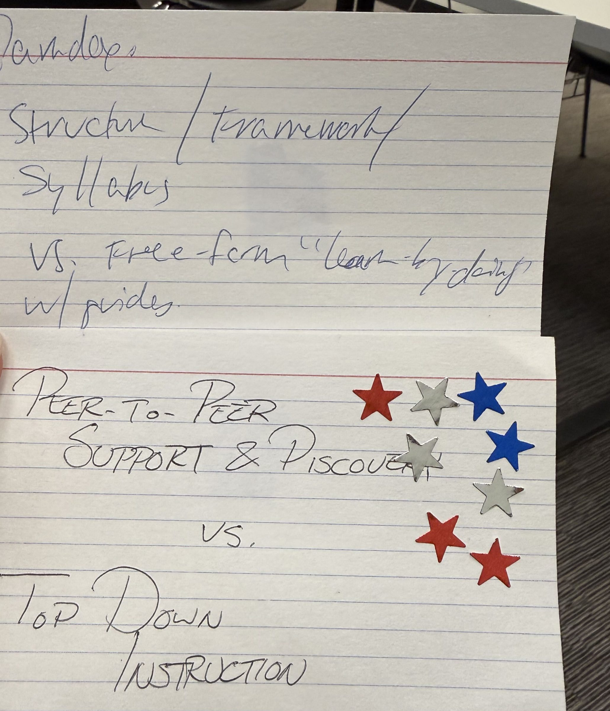
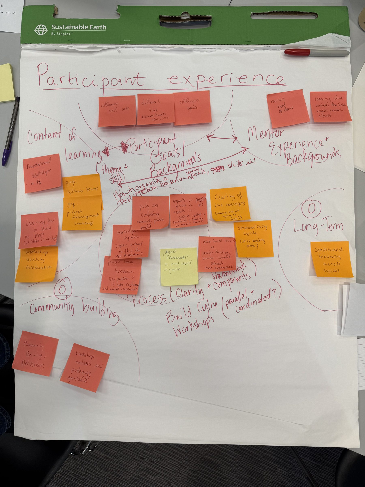
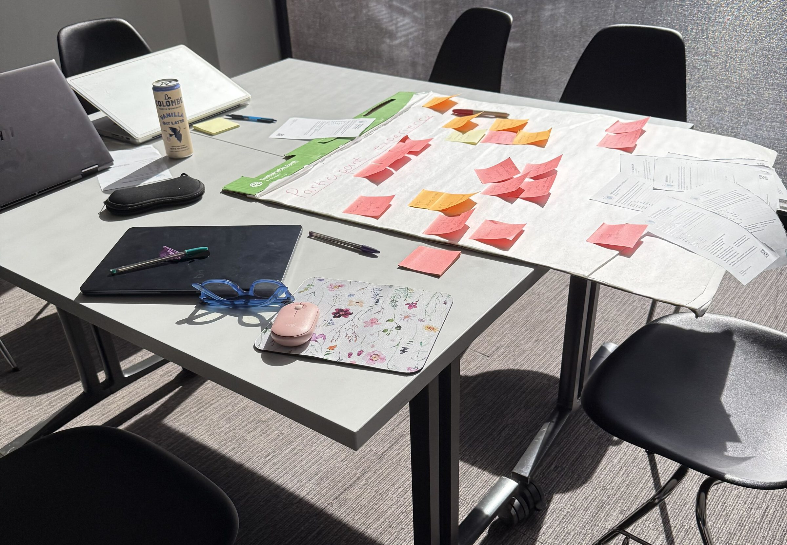
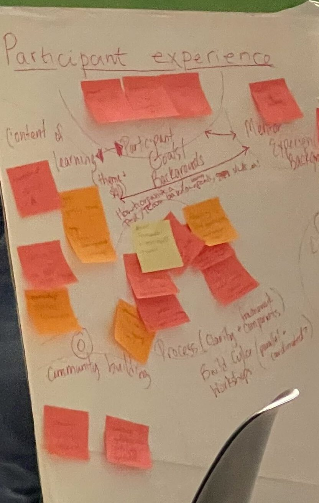
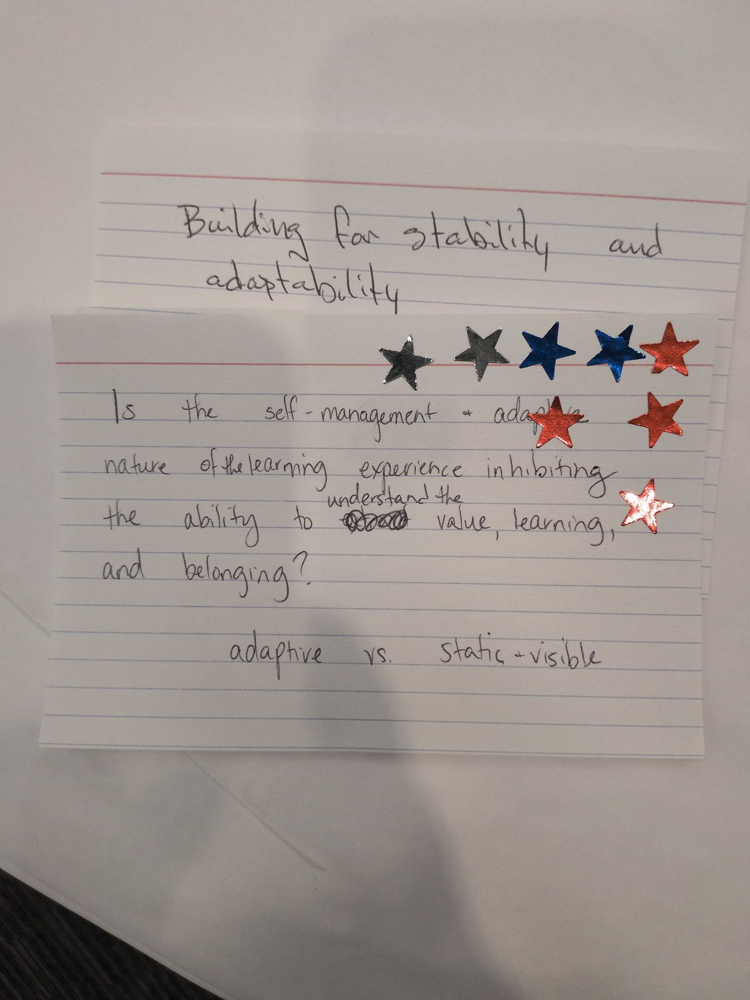
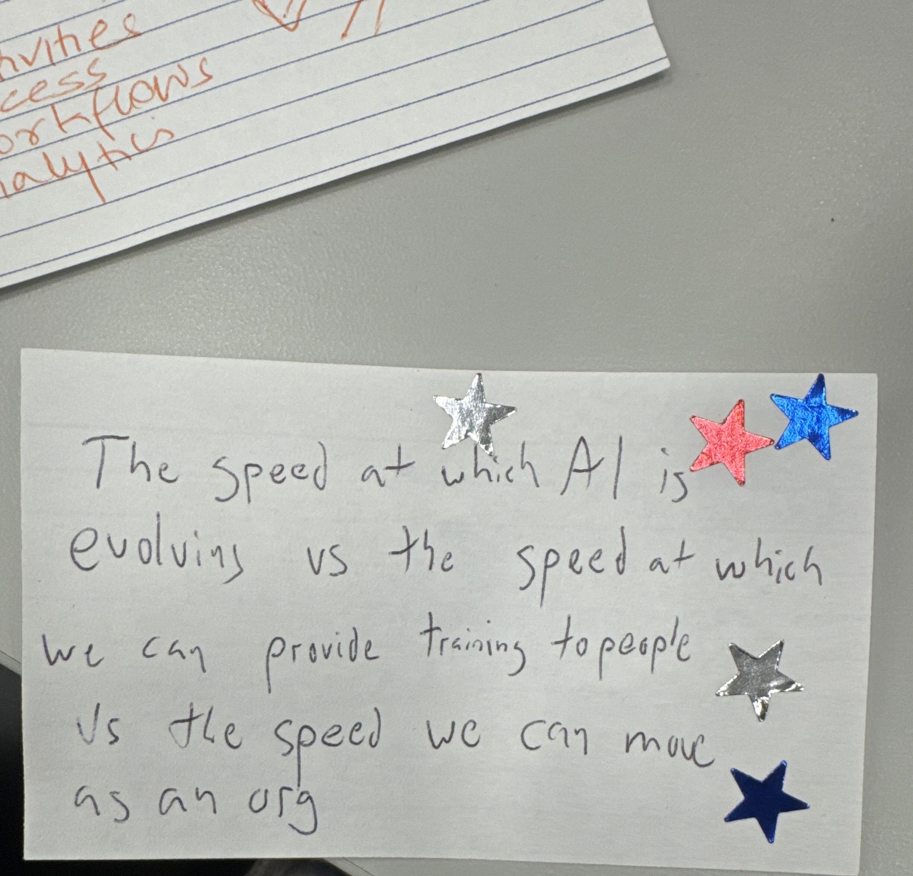
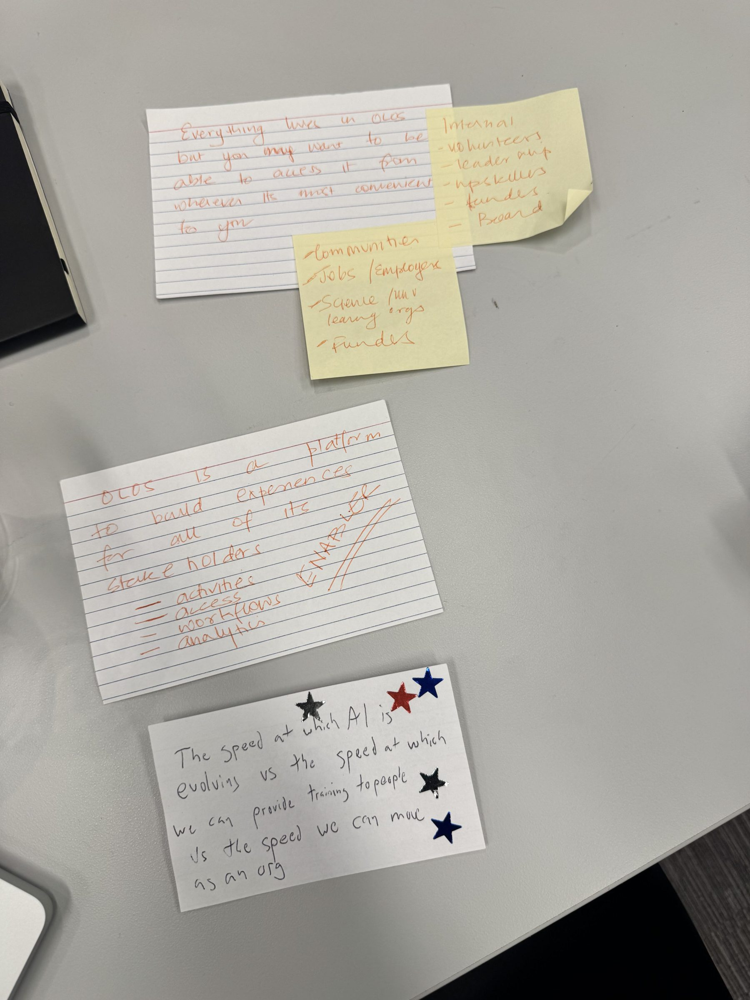
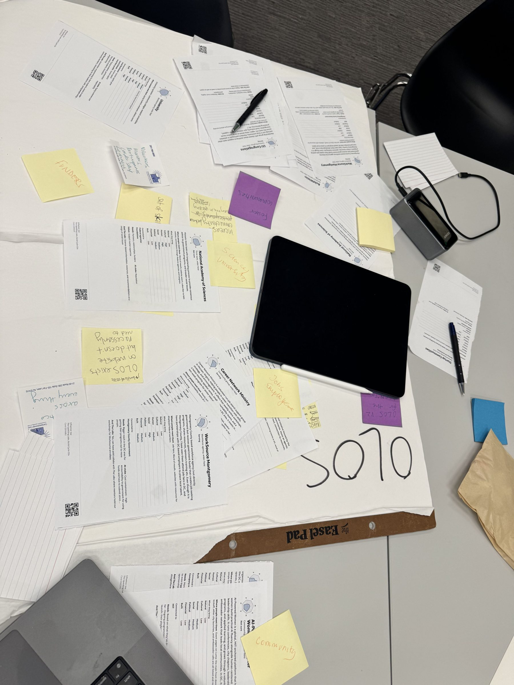
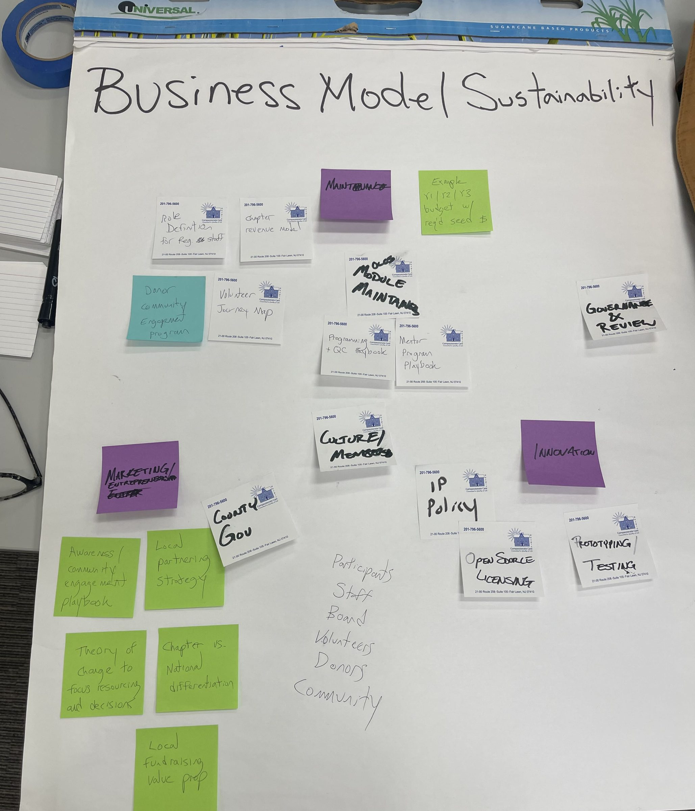
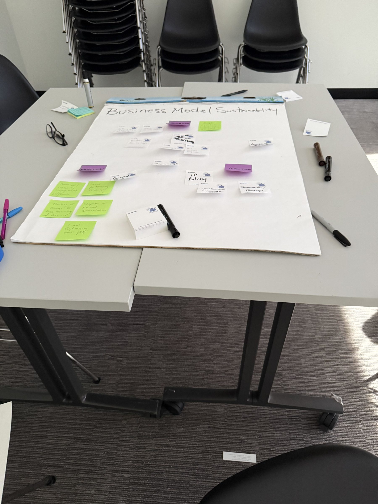

# Sensemaking day, Oct 24

Where the three pods came from. On sensemaking day each table worked a tension from the Oct 3 retreat, sorted the survey and the stakeholder cards, and wrote what it found on a card. The room voted on the cards with stars, and three of them became the pods.

Photos of the cards, the group sheets and the tables, cropped so no one is in them; the repo is public.

## Scaffolding

The card, 9 stars:

> Structure / framework / syllabus vs. free-form "learn-by-doing" w/ guides
>
> Peer-to-peer support & discovery vs. top-down instruction

The group's sheet, "Participant experience": content of learning, participant goals and backgrounds, mentor experience and backgrounds, process, community building and the long term. Among the notes: "pods are confusing (research phase vs. project)", "clarity of the messaging (where are we going in cycle?)", "project team formation in-person? It was confusing and needed clarification", "streamlining cycle (less waiting time)", "mentors need guidance", "continued learning across cycles".

The table while it worked, and the sheet as the group presented it to the room:

## Wayfinding

The card, 9 stars:

> Building for stability and adaptability
>
> Is the self-management + adaptive nature of the learning experience inhibiting the ability to understand the value, learning, and belonging?
>
> Adaptive vs. static + visible

No photo of this group's sheet was posted. If you have one, add it here.

## Front Door

The card, 6 stars:

> The speed at which AI is evolving vs the speed at which we can provide training to people vs the speed we can move as an org

The group's notes: "Everything lives in OLOS, but you may want to be able to access it from wherever it's most convenient to you", with the people inside (volunteers, leadership, upskillers, funders, the Board) and outside (communities, jobs and employers, science and university learning orgs, funders). And: "OLOS is a platform to build experiences for all of its stakeholders: activities, access, workflows, analytics. Enabler."

The "OLOS" table, with the stakeholder cards the group sorted. Among the stickies: "OLOS exists on website but doesn't necessarily need to", "jobs / employers", "community", "foster communities", "science / university".

## A fourth group: Business Model / Sustainability

This table didn't become a pod. Its sheet: theory of change to focus resources and decisions, chapter vs. national differentiation, local fundraising value prop, local partnering strategy, an awareness and community engagement playbook, a chapter revenue model, an example Y1/Y2/Y3 budget with required seed money, IP policy, open source licensing, governance and review, module maintainers, a mentor program playbook, a programming and QC playbook, a volunteer journey map, role definitions for regional staff, and a donor community engagement program. The people it lists: participants, staff, the Board, volunteers, donors, community.

---

From #c04-all on The Labs' Slack, Oct 24. The uncropped photos, including the ones of the room, are in the Cycle's shared photo folder.
